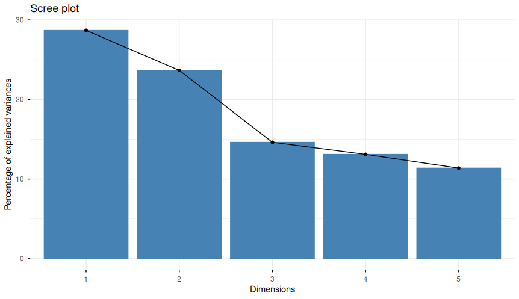
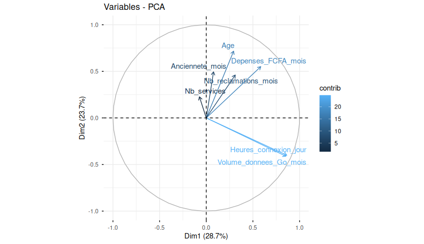
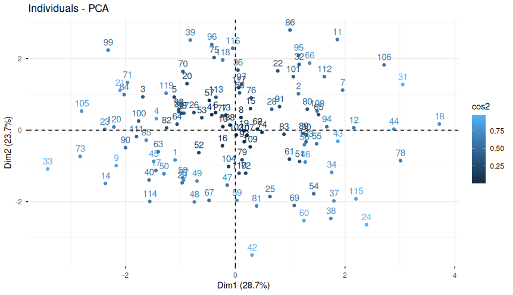

# Guide de débutant : Analyse de données avec RStudio
*Ce document documente pas à pas la réalisation du TP3 pour quelqu'un qui part de zéro en R et en analyse de données.*

## 1. Mise en route et Environnement

### Le problème du conteneur (Docker)
Quand on utilise RStudio via un conteneur, l'environnement de travail est isolé de notre ordinateur physique. RStudio ne peut pas accéder directement aux dossiers de notre PC (comme "Documents" ou "Téléchargements").

### Installation et Chargement des outils (Packages)

Pour faire des analyses avancées, R a besoin de "packages" (des extensions). 

**1. L'installation (`install.packages`)**
C'est l'étape où on télécharge l'outil sur la machine. On ne le fait qu'une seule fois. 

**Les outils utilisés dans ce TP :**
- `FactoMineR` : Le moteur pour réaliser les analyses factorielles (ACP et AFC).
- `factoextra` : Pour transformer les résultats mathématiques en beaux graphiques.
- `dplyr` : L'outil indispensable pour manipuler, filtrer et nettoyer les tableaux.
- `ggplot2` : La référence pour créer des graphiques personnalisés et professionnels.
- `cluster` : Contient les algorithmes de regroupement comme le K-means.
- `rpart` : Utilisé pour créer des arbres de décision (prédiction).

*Note : Dans notre cas, les packages étaient déjà pré-installés dans le conteneur.*

**2. Le chargement (`library`)**
Installer un outil ne suffit pas : il faut dire à R de l'ouvrir pour la session actuelle.

**La commande pour charger un outil :**
```r
library(dplyr)
```

**À savoir :** Si R affiche un message disant que certains objets sont *"masked from package:stats"*, ce n'est pas une erreur. Cela signifie simplement que le package chargé possède des fonctions qui portent le même nom que des fonctions de base de R, et qu'il utilisera les siennes.

## 2. Importation et Exploration des données

### Importer le fichier CSV
Une fois le fichier présent dans le conteneur, on doit le charger dans la mémoire de R pour pouvoir l'analyser.

**La commande :**
```r
donnees <- read.csv("jeu_donnees_clients_telecom.csv", na.strings = c("", "NA"))
```

**Explication :**
- `donnees <-` : On crée une **variable** (une boîte) nommée `donnees` pour stocker notre tableau.
- `read.csv()` : La fonction qui lit le fichier.
- `na.strings = c("", "NA")` : Indique à R que les cases vides ou le texte "NA" doivent être traités comme des valeurs manquantes.

### Explorer et vérifier les données
Avant de lancer des calculs, on doit vérifier que le tableau a été bien importé et comprendre sa structure.

**1. Vérifier la taille :**
```r
dim(donnees)
```
Affiche le nombre de lignes et de colonnes. Ici : `120 12`.

**2. Analyser la structure :**
```r
str(donnees)
```
Permet de voir le type de chaque colonne : `num` (nombre), `int` (entier) ou `chr` (caractères/texte).

**3. Résumé statistique :**
```r
summary(donnees)
```
Donne un aperçu rapide (moyenne, médiane, min, max) pour chaque variable.

**4. Repérer les données manquantes :**
```r
colSums(is.na(donnees))
```
Compte le nombre de valeurs manquantes (`NA`) pour chaque colonne. C'est essentiel pour savoir si on doit "nettoyer" les données avant l'analyse.

## 3. Préparation pour l'ACP (Analyse en Composantes Principales)

L'ACP est une technique qui permet de simplifier un grand tableau de chiffres en quelques "axes" principaux. Elle ne fonctionne **que** sur des données numériques.

### Étape 1 : Sélection des variables quantitatives
On doit exclure l'identifiant du client (qui n'est pas une mesure) et les colonnes de texte.

**La commande :**
```r
vars_quant <- c("Age", "Anciennete_mois", "Heures_connexion_jour", "Volume_donnees_Go_mois", "Depenses_FCFA_mois", "Nb_services", "Nb_reclamations_mois")
X <- donnees[, vars_quant]
```
*Attention : Il faut utiliser exactement les noms de colonnes affichés par `str(donnees)`.*

### Étape 2 : Traitement des valeurs manquantes (Imputation)
L'ACP ne peut pas fonctionner s'il y a des "trous" (`NA`) dans les données. La solution la plus simple est l'**imputation par la moyenne** : on remplace chaque valeur manquante par la moyenne de sa colonne.

**La commande :**
```r
imputer_moyenne <- function(x) {
  x[is.na(x)] <- mean(x, na.rm = TRUE)
  return(x)
}
X_prep <- as.data.frame(lapply(X, imputer_moyenne))
```
**Explication :**
- On crée une fonction `imputer_moyenne` qui identifie les `NA` et les remplace par la moyenne (`mean`).
- `na.rm = TRUE` permet de calculer la moyenne en ignorant les cases vides.
- `lapply` applique cette règle à toutes les colonnes du tableau.

### Étape 3 : Lancement de l'ACP Normée
L'ACP est "normée" pour éviter que les variables avec de grands chiffres (ex: les dépenses) n'écrasent celles avec de petits chiffres (ex: l'âge).

**La commande :**
```r
library(FactoMineR)
library(factoextra)

res_acp <- PCA(X_prep, scale.unit = TRUE, graph = FALSE)
```
**Explication :** `scale.unit = TRUE` active la normalisation (centrer-réduire).

### Étape 4 : Choix du nombre d'axes (Dimensions)
On ne garde pas tous les axes, seulement ceux qui portent le plus d'information.

**La commande :**
```r
print(res_acp$eig)
fviz_eig(res_acp, addlabels = TRUE)
```

**Comment choisir ?**
1. **La règle de Kaiser** : On garde les axes dont la valeur propre (`eigenvalue`) est $> 1$.
2. **Le coude du graphique** : On cherche l'endroit où la courbe s'aplatit.



*Dans notre cas, nous avons gardé les 3 premières dimensions, ce qui représente environ 67% de la variance totale.*

### Étape 5 : Interpréter les variables (Cercle des corrélations)
Le but est de donner un "nom" aux axes pour comprendre ce qu'ils représentent.

**La commande pour visualiser :**
```r
fviz_pca_var(res_acp, col.var = "contrib", repel = TRUE)
```



**La commande pour être précis (Tableau des contributions) :**
```r
res_acp$var$contrib
```

**Comment lire les résultats ?**
- **Le Tableau (`contrib`)** : C'est la source de vérité. On regarde quelle colonne (Dim 1, Dim 2...) a les chiffres les plus élevés pour chaque variable.
    - *Exemple :* Si `Volume_donnees` est très élevé en Dim 1, alors l'axe 1 représente l'usage des données.
- **Le Cercle (Visuel)** : 
    - **L'Axe 1 (Horizontal)** : Les variables dont la flèche est presque horizontale.
    - **L'Axe 2 (Vertical)** : Les variables dont la flèche est presque verticale.
    - **L'Angle** : Deux flèches proches = variables liées positivement. Deux flèches opposées = variables liées négativement.

**Analyse de notre TP :**
- **Axe 1** $\rightarrow$ Dominé par `Heures_connexion_jour` et `Volume_donnees_Go_mois`. **Axe de la Consommation Numérique**.
- **Axe 2** $\rightarrow$ Dominé par l' `Age`. **Axe du Profil Démographique**.
- **Axe 3** $\rightarrow$ Dominé par `Nb_services`.

### Étape 6 : Projection des individus
On place maintenant chaque client sur la carte pour voir s'ils forment des groupes naturels.

**La commande :**
```r
fviz_pca_ind(res_acp, col.ind = "cos2", repel = FALSE)
```



**Observation :** Le résultat est souvent un "nuage de points" assez brouillon. L'absence de groupes visuellement distincts justifie l'utilisation d'un algorithme de classification (K-means) pour définir des groupes précis.

### Étape 7 : Conclusions de l'ACP
L'analyse nous permet de tirer deux conclusions majeures :
1. **Lien Usage/Volume** : Il existe une corrélation très forte entre le temps de connexion et le volume de données consommé.
2. **Segmentation** : On peut segmenter les clients selon deux dimensions principales : leur intensité d'usage numérique (Axe 1) et leur profil démographique (Axe 2).
